<div align="center">

# PulseMonitor — API Monitoring Platform

**A full-stack API monitoring platform with scheduled health checks, response-time analytics, incident tracking, encrypted API credentials, and role-based administration.**


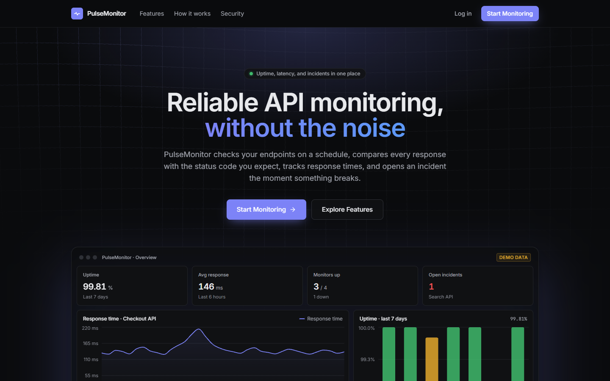

</div>

## Overview

APIs fail quietly. An endpoint can start returning `503`s, time out, or slow down for a while before anyone notices. PulseMonitor checks your HTTP endpoints on a schedule and compares each response with the status code you expect. It records the response time, and opens an incident as soon as a check fails. The incident resolves on its own once the endpoint recovers.

**Who it's for:** developers and small teams who run their own APIs and want a single place to see uptime, latency, and outages. That includes endpoints protected by an API key or bearer token.

**Highlights**

- **Scheduled checks** of any public HTTP(S) endpoint, with your chosen method, expected status code, and interval.
- **Response-time and uptime analytics**, built from stored check history.
- **Automatic incidents** that open on failure and resolve on recovery, with no duplicates.
- **Authenticated monitoring**: custom request headers whose values are encrypted at rest and never returned by the API.
- **SSRF protection**: private, loopback, link-local, and cloud-metadata addresses are blocked when you save a URL and again at every check, including after DNS resolution.
- **Admin portal** with platform statistics, user and role management, and read-only views of every monitor and incident.

## Contents

- [Screenshots](#screenshots)
- [Features](#features)
- [Tech stack](#tech-stack)
- [Architecture](#architecture)
- [Getting started](#getting-started)
- [API reference](#api-reference)
- [Security](#security)
- [Project structure](#project-structure)
- [Testing](#testing)
- [Limitations and roadmap](#limitations-and-roadmap)
- [Contributing](#contributing)
- [License](#license)

## Screenshots

The screenshots below show the real application running locally against a throwaway database of sample data. The accounts, monitors, and URLs are placeholders, and no real credentials appear in any image.

| User dashboard | Analytics |
| --- | --- |
| 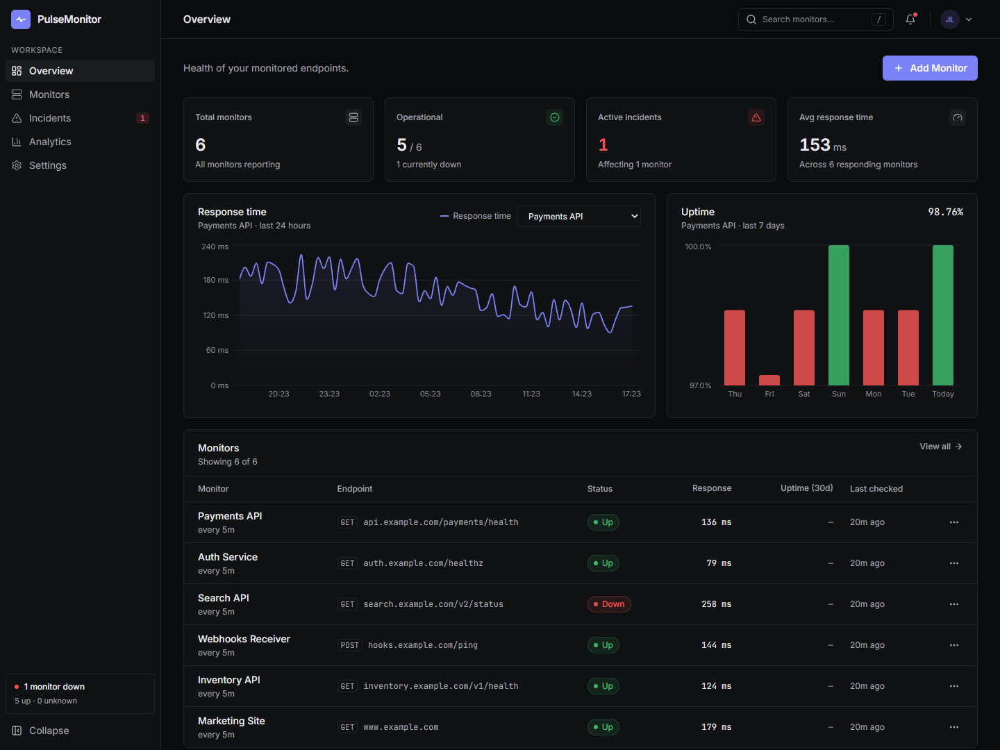 | 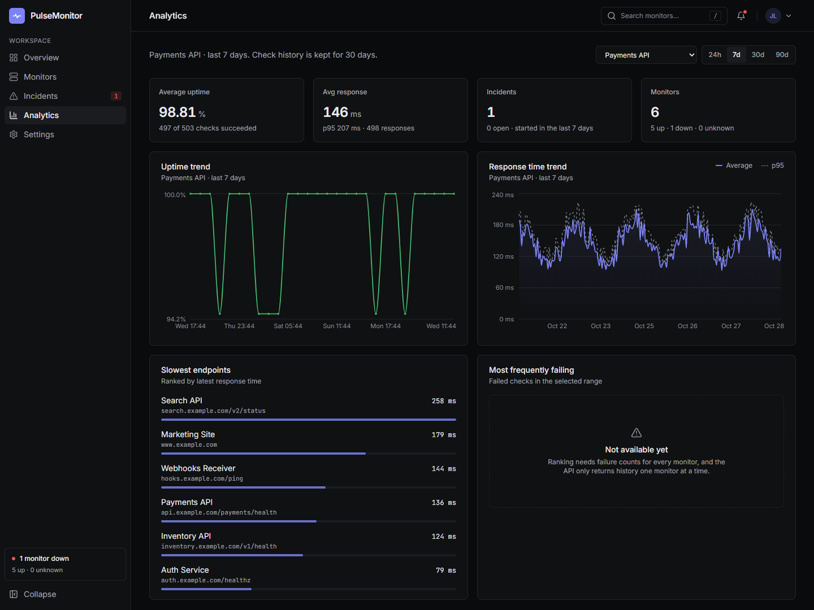 |
| Stats, a 24-hour response-time chart, daily uptime, and every monitor's latest result. | Uptime and response-time (average and p95) trends per monitor over 24 h, 7 d, 30 d, or 90 d. |

| Monitor form with request headers | Incidents |
| --- | --- |
| 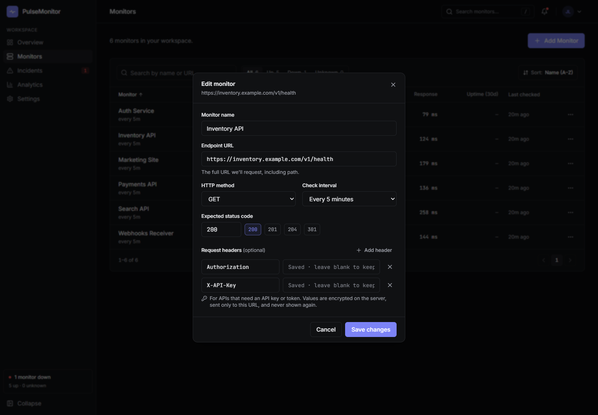 | 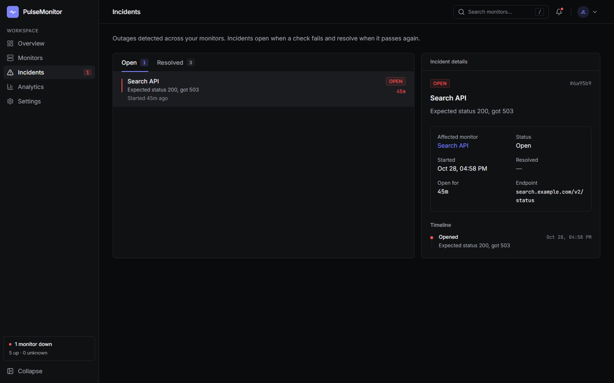 |
| Saved header values are never sent back. They show as "Saved · leave blank to keep". | Open and resolved incidents, each with its monitor, reason, duration, and timeline. |

| Admin dashboard | Admin user management |
| --- | --- |
| 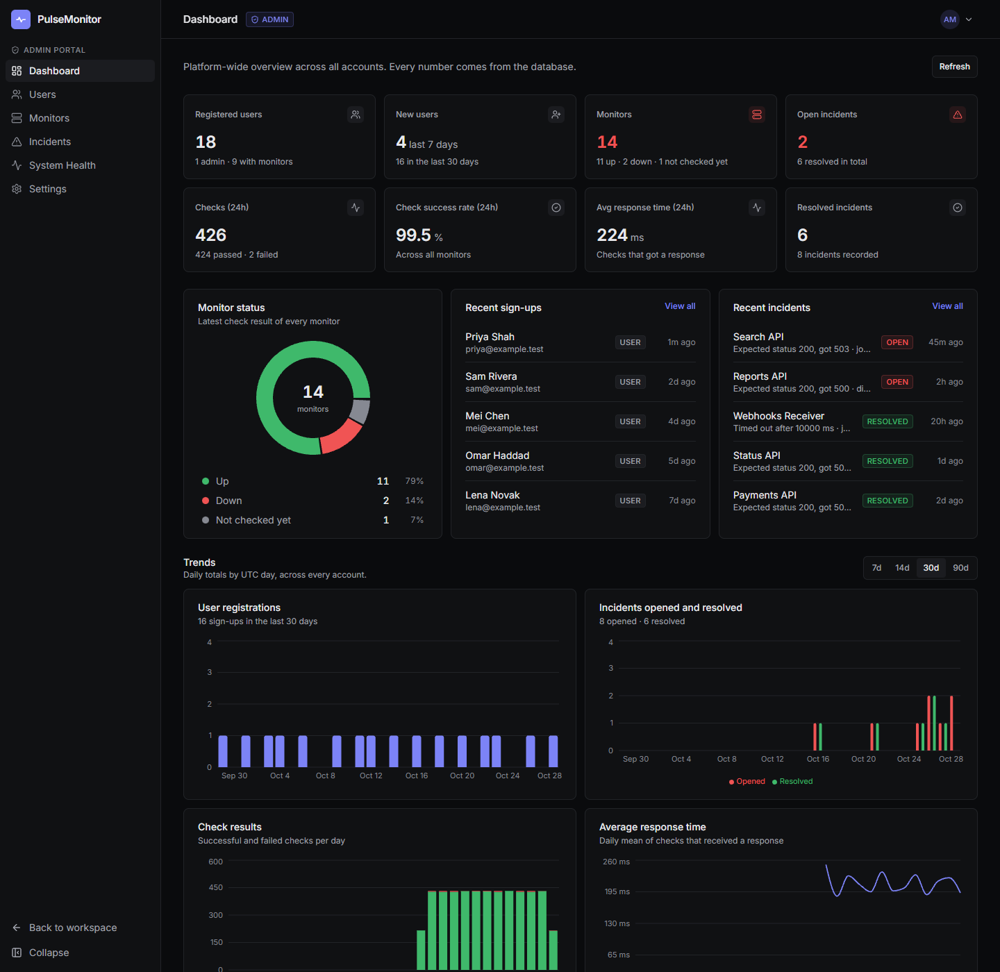 | 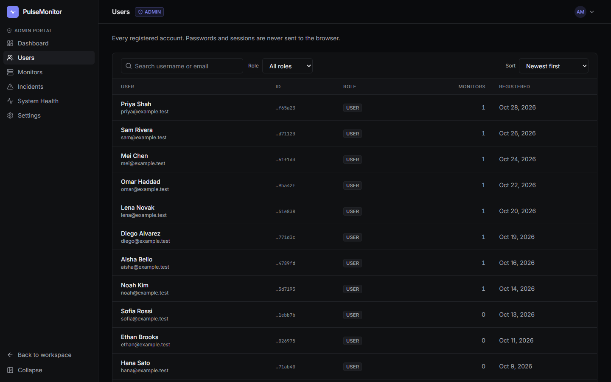 |
| Platform-wide totals, monitor status, recent sign-ups and incidents, and 7–90 day trends. | Searchable, paginated accounts. A detail panel shows each user's monitors and lets you change roles. |

<details>
<summary>More screenshots: monitors, admin monitor view, login and signup</summary>

| Monitors | Admin: all monitors |
| --- | --- |
| 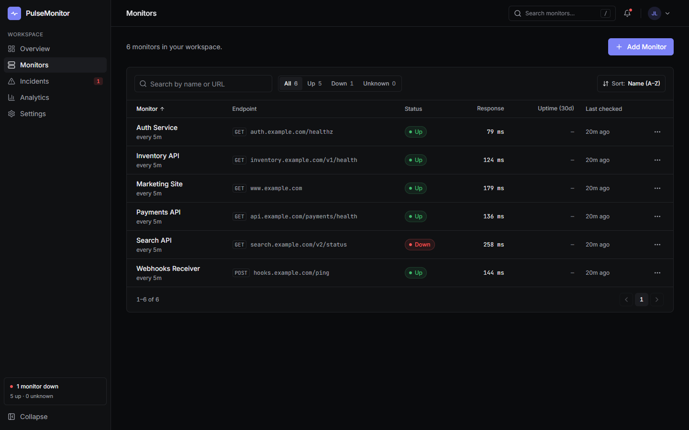 | 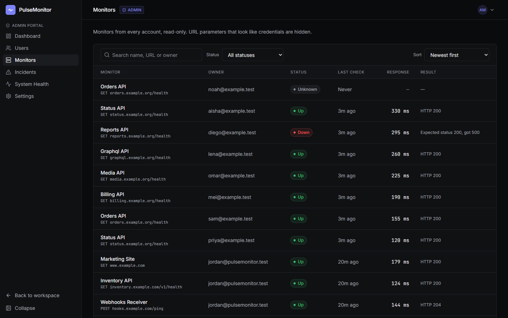 |

| Log in | Sign up |
| --- | --- |
| 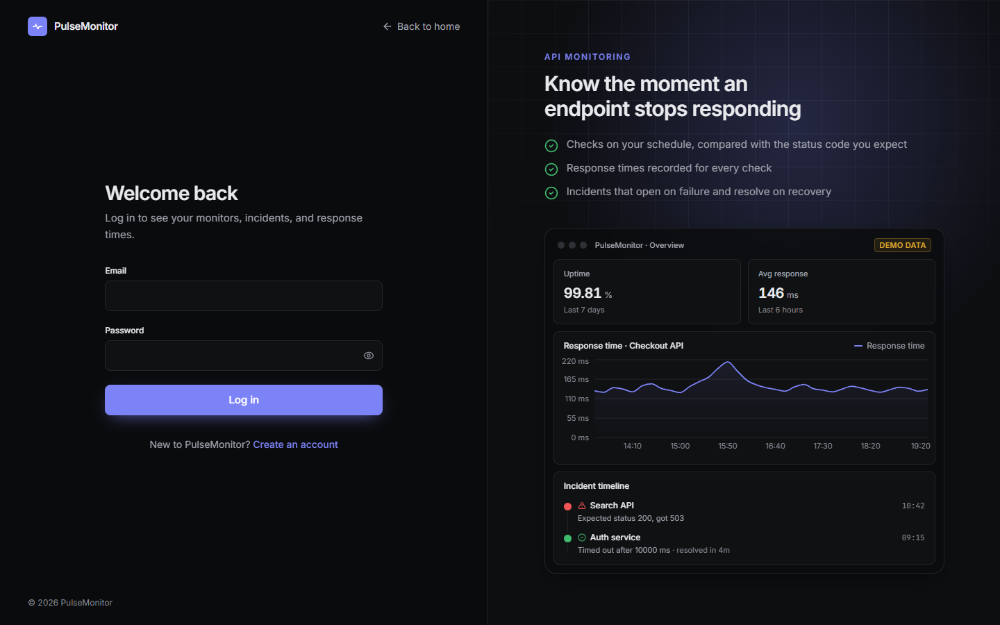 | 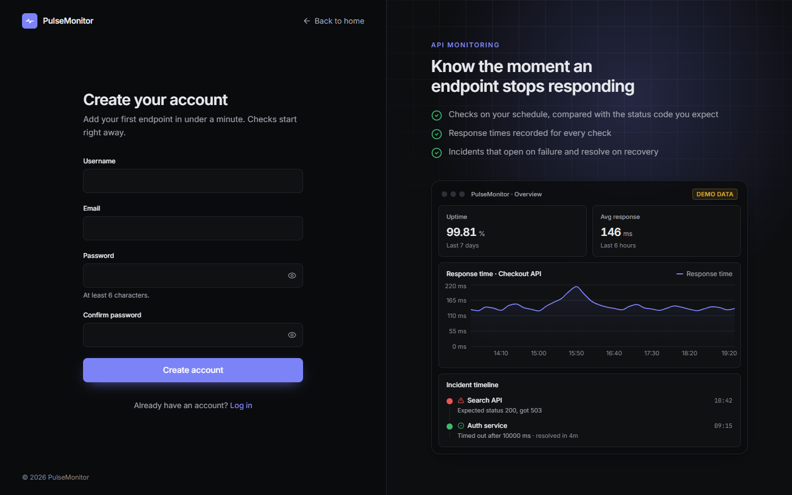 |

The dashboard previews on the landing, login, and signup pages are marketing illustrations, and they're labelled **Demo data** in the app itself.

</details>

## Features

### Accounts and sessions
- Sign up, log in, and log out, with validation messages for each field.
- Sessions use an HttpOnly JWT cookie. Protected pages redirect to the login page and remember where you were going.
- The session ends cleanly on expiry, and signing out in one tab signs you out in your other open tabs too.

### Monitors
- Create, edit, and delete monitors. Each has a name, an HTTP(S) URL, a method (`GET`, `POST`, `PUT`, `PATCH`, `DELETE`), an expected status code, and an interval (1, 5, 10, or 30 minutes).
- Each monitor shows its status (`up`, `down`, or `unknown` until the first check), last check time, last status code, response time, and last error.
- You can search, filter by status, and sort monitors.

### Scheduled health checks
- A scheduler in the backend finds due monitors every 5 seconds and checks them in parallel, up to 10 at a time by default. A monitor is never checked twice at once.
- Each check measures the time to the response headers. It never downloads the response body, never follows redirects, and times out after 10 seconds by default.
- Every check is stored as a check result. Check results expire after 30 days by default.
- If you edit a monitor while it's being checked, that check's result isn't applied to the edited monitor.

### Analytics
- **Overview:** a 24-hour response-time chart and daily uptime for the last 7 days, for any monitor.
- **Analytics page:** uptime and response-time (average and p95) trends over 24 h, 7 d, 30 d, or 90 d, plus your endpoints ranked by latest response time.
- Charts show gaps where no checks were recorded instead of inventing values.

### Incidents
- An incident opens on the first failed check, recording the reason (for example `Expected status 200, got 503` or `Timed out after 10000 ms`). It resolves at the first successful check after that.
- Repeated failures don't open duplicate incidents.
- The incidents page has Open and Resolved tabs, details, durations, and a timeline. The notifications menu lists recent outages and recoveries.

### Authenticated API monitoring
- Add up to 10 custom request headers per monitor, such as `Authorization: Bearer …` or `X-API-Key: …`.
- Header values are encrypted with AES-256-GCM before they're stored, and they can't be read back. The API returns only `{ name, configured: true }`.
- Each encrypted value is tied to its monitor and header name, so a value copied into another monitor or header won't decrypt.
- If you change a monitor's URL to a different host, you must enter every saved value again. A saved credential is never sent to a host it wasn't entered for.
- Header names must be valid HTTP header names. Values can't contain line breaks or control characters (which blocks header injection). Routing and connection headers such as `Host`, `Content-Length`, `Transfer-Encoding`, `Proxy-*`, and `X-Forwarded-*` are rejected.

### SSRF protection
- URLs must be `http` or `https` and can't contain a username or password.
- `localhost`, `*.local`, and `*.internal` are rejected, as are private, loopback, link-local (including `169.254.169.254`), CGNAT, multicast, and reserved IP addresses. This covers IPv4, IPv6, IPv4-mapped forms, and tricks like decimal or hex IP addresses.
- The URL is checked again at every check. If the hostname resolves to any blocked address, the check is refused, and the connection goes to the exact address that was checked, so DNS rebinding can't slip in an internal address.

### Admin portal
- Available only to accounts with the `admin` role, and enforced on the server for every `/api/admin` request.
- **Dashboard:** user, monitor, incident, and check totals, a monitor status chart, recent sign-ups and incidents, and daily trends for registrations, incidents, check results, and response time.
- **Users:** search, a role filter, sorting, and pagination. A detail panel shows each user's monitors and incidents, and lets you promote or demote them after a confirmation step. Admins can't change their own role.
- **Monitors and Incidents:** every account's monitors and incidents, read-only, with search, filters, sorting, and pagination. Monitor URL query values that look like credentials (for example `?api_key=`) are shown as `REDACTED`.
- **System Health:** database state and ping, scheduler state, last check time, overdue monitors, and server uptime and memory.
- **Settings:** the server's effective configuration, read-only. Secrets are never shown.

### Interface
- Responsive layout with light and dark themes, a collapsible sidebar, and keyboard-friendly menus and dialogs.
- Loading skeletons, empty states, and error states with a retry button on data views.
- Subtle entrance and scroll animations that respect reduced-motion settings.
- **3D landing background:** a WebGL grid that ripples as one continuous wave; mouse movement changes the wave's direction and strength. It's static when reduced motion is on and on touch devices, and falls back to a plain CSS grid when WebGL isn't available.

## Tech stack

| Area | Technology | Role |
| --- | --- | --- |
| Frontend | React 18, React Router 6 | Single-page app, routing, and route guards for signed-in users and admins |
| Styling | Tailwind CSS 3, PostCSS | Utility styles on CSS variables, with light and dark themes |
| Charts | Recharts 2 | Response-time, uptime, and admin analytics charts |
| Icons | lucide-react | Interface icons |
| 3D background | WebGL (no library) | Shader that draws the landing page's wave grid |
| Build | Vite 5 | Dev server (with the `/api` proxy) and production builds |
| Backend | Node.js, Express 5 | REST API and the monitoring scheduler |
| Database | MongoDB, Mongoose 9 | Users, monitors, check results (with automatic expiry), and incidents |
| Auth | jsonwebtoken, cookie-parser, bcrypt | Signed JWTs in HttpOnly cookies, and password hashing |
| HTTP checks | Node `http`, `https`, `dns`, `net` | Requests, DNS checks for SSRF protection, and blocked-address lists |
| Credentials | Node `crypto` (AES-256-GCM) | Encrypting custom header values |
| Config | dotenv | Loads `backend/.env` |
| Testing | Jest 29, Supertest 7 | API, scheduler, security, and SSRF tests against isolated databases |

## Architecture

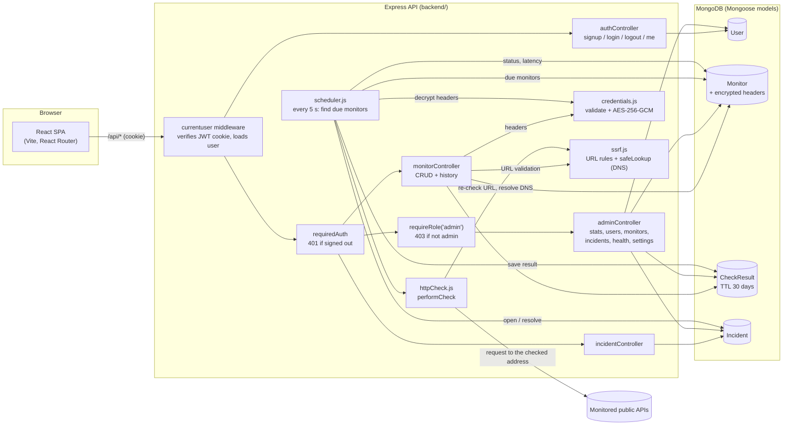

**How a request flows.** Every `/api` request passes through `currentuser`, which verifies the JWT cookie (signature, `HS256` algorithm, and expiry) and loads the user from MongoDB. `requiredAuth` turns away signed-out requests with `401`. Monitor and incident queries are always filtered by the signed-in user's id, so another user's monitor returns `404`. `/api/admin/*` also passes through `requireRole("admin")`, which reads the role from the database on every request, so a demoted admin loses access immediately.

**How a check flows.** `startScheduler()` runs once the database connects. Every 5 seconds it finds monitors whose interval has passed, decrypts any saved headers, and calls `performCheck`. That function checks the URL again, resolves DNS through `safeLookup`, which refuses private addresses, and connects to the exact address it checked. It stores a `CheckResult`, then updates the monitor's status and latest-check fields, but only if the monitor wasn't edited during the check. Finally it opens an incident on failure, or resolves the open one on success.

## Getting started

### Prerequisites

- **Node.js 20.19 or newer**, with npm. Mongoose 9 and the MongoDB driver need at least 20.19; the project was developed on Node 22.
- **MongoDB** running locally on `mongodb://localhost:27017`.

### 1. Clone and install

```bash
git clone <your-repository-url> pulsemonitor
cd pulsemonitor

cd backend && npm install
cd ../frontend && npm install
cd ..
```

### 2. Configure the backend

```bash
cp backend/.env.example backend/.env
```

Generate the two secrets and paste them into `backend/.env`:

```bash
# JWT_SECRET (required, at least 32 characters)
node -e "console.log(require('crypto').randomBytes(48).toString('hex'))"

# MONITOR_CREDENTIALS_KEY (needed for custom request headers; 32 bytes)
node -e "console.log(require('crypto').randomBytes(32).toString('base64'))"
```

`backend/.env` should end up like this (placeholders shown):

```dotenv
JWT_SECRET=<64+ random hex characters>
MONITOR_CREDENTIALS_KEY=<44-character base64 key>
NODE_ENV=development
# Optional: JWT_TTL_SECONDS, COOKIE_SAME_SITE, COOKIE_SECURE,
# MONITOR_TIMEOUT_MS, MONITOR_MAX_CONCURRENCY, CHECK_RETENTION_DAYS
```

- **`JWT_SECRET` is required.** The server refuses to start without it, and there is no fallback secret.
- **`MONITOR_CREDENTIALS_KEY` must stay stable.** Without it, monitors still work but can't be given headers. If the key changes, previously saved header values can't be decrypted: those checks fail with a "can't be decrypted; re-enter it" error until you enter the values again. Keep it secret, and keep it in a secret manager in production.

The frontend needs no configuration in development. Its `.env.example` documents `VITE_API_URL` and `VITE_API_PROXY` for other setups.

### 3. MongoDB

The backend connects to `mongodb://localhost:27017/APImanagement`. That URL is currently set in `backend/app.js`. Start MongoDB locally, for example with MongoDB Community Server or with Docker:

```bash
docker run -d --name pulsemonitor-mongo -p 27017:27017 mongo
```

### 4. Run the app

In two terminals:

```bash
# Terminal 1 — API on http://localhost:5000 (starts the scheduler)
cd backend
npm run dev        # or: npm start
```

```bash
# Terminal 2 — app on http://localhost:5173 (proxies /api to :5000)
cd frontend
npm run dev
```

Open http://localhost:5173 and create an account.

### 5. Create the first admin

There's no web route that makes an account an admin, and sign-up ignores any `role` field. Sign up normally, then run this on the server:

```bash
cd backend
npm run set-role -- --email you@example.com --role admin
```

The script only changes the role of an existing account. It refuses to remove the last admin, and it prints only the email and the new role. After that, admins can manage roles from **Admin Portal → Users**.

### 6. Tests and production build

```bash
cd backend && npm test          # Jest + Supertest, needs MongoDB on 127.0.0.1:27017
cd frontend && npm run build    # production bundle in frontend/dist
```

## API reference

All endpoints are under `/api`. They take and return JSON and authenticate with the `jwt` cookie that login and signup set. Errors come back as `{ "error": "..." }`, or as `{ "errors": { "field": "message" } }` for validation errors.

### Auth

| Method | Endpoint | Purpose | Access |
| --- | --- | --- | --- |
| `POST` | `/api/signup` | Create an account (`username`, `email`, `password`) and start a session | Public |
| `POST` | `/api/login` | Log in (`email`, `password`) and start a session | Public |
| `POST` | `/api/logout` | Clear the session cookie | Public |
| `GET` | `/api/me` | Current user: `id`, `username`, `email`, `role` | Signed in |

### Monitors and incidents

| Method | Endpoint | Purpose | Access |
| --- | --- | --- | --- |
| `POST` | `/api/monitor` | Create a monitor | Signed in |
| `GET` | `/api/monitor` | List your monitors | Signed in |
| `GET` | `/api/monitors/:id` | Get one of your monitors | Owner |
| `PATCH` | `/api/monitors/:id` | Update a monitor; fields you leave out stay unchanged | Owner |
| `DELETE` | `/api/monitors/:id` | Delete a monitor | Owner |
| `GET` | `/api/monitors/:id/history` | Stored check results, newest first | Owner |
| `GET` | `/api/incidents` | Your incidents, newest first, with monitor name and URL | Signed in |

### Admin

Every admin endpoint needs a signed-in admin: signed-out requests get `401` and other users get `403`. Lists take `page` and `limit` (1–100), plus `search`, filters, and `sort` (for example `sort=-createdAt`).

| Method | Endpoint | Purpose |
| --- | --- | --- |
| `GET` | `/api/admin/stats` | Totals, the last 24 h of checks, recent sign-ups and incidents |
| `GET` | `/api/admin/analytics?days=7\|14\|30\|90` | Daily series by UTC day |
| `GET` | `/api/admin/users` | Users (`search`, `role`, `sort`) |
| `GET` | `/api/admin/users/:id` | A user's details, monitors, and incidents |
| `PATCH` | `/api/admin/users/:id/role` | Set `role` to `client` or `admin` (not allowed on yourself) |
| `GET` | `/api/admin/monitors` | All monitors (`search`, `status`, `userId`, `sort`) |
| `GET` | `/api/admin/monitors/:id` | A monitor with its last 50 checks and recent incidents |
| `GET` | `/api/admin/incidents` | All incidents (`search`, `status`, `monitorId`, `userId`, `sort`) |
| `GET` | `/api/admin/health` | Database, scheduler, and process health |
| `GET` | `/api/admin/settings` | The effective configuration, without secrets |

### Examples

The ids and values below are placeholders.

**Log in**

```http
POST /api/login
Content-Type: application/json

{ "email": "you@example.com", "password": "<password>" }
```

```http
HTTP/1.1 200 OK
Set-Cookie: jwt=<token>; Max-Age=86400; Path=/; Expires=<date>; HttpOnly; SameSite=Lax

{ "user": "<userId>" }
```

**Create a monitor with an API key**

```http
POST /api/monitor
Content-Type: application/json

{
  "name": "Inventory API",
  "url": "https://inventory.example.com/v1/health",
  "method": "GET",
  "interval": 300,
  "expectedStatusCode": 200,
  "headers": [{ "name": "X-API-Key", "value": "<your key>" }]
}
```

```json
{ "monitor": "<monitorId>" }
```

**List monitors.** Header values are never returned:

```json
{
  "monitors": [
    {
      "_id": "<monitorId>",
      "userId": "<userId>",
      "name": "Inventory API",
      "url": "https://inventory.example.com/v1/health",
      "method": "GET",
      "interval": 300,
      "expectedStatusCode": 200,
      "status": "up",
      "lastCheckedAt": "2026-10-28T11:30:00.000Z",
      "lastStatusCode": 200,
      "lastResponseTime": 124,
      "lastError": null,
      "headers": [{ "name": "X-API-Key", "configured": true }],
      "createdAt": "2026-10-20T09:00:00.000Z",
      "updatedAt": "2026-10-28T11:30:00.000Z",
      "__v": 0
    }
  ]
}
```

**Update headers.** An entry with a name but no value keeps its saved value. Headers you leave out of the list are removed:

```http
PATCH /api/monitors/<monitorId>
Content-Type: application/json

{ "headers": [{ "name": "X-API-Key" }, { "name": "Authorization", "value": "Bearer <token>" }] }
```

**Rejected URL (SSRF)**

```json
{
  "errors": {
    "name": "",
    "url": "Private, loopback, link-local, and reserved addresses cannot be monitored",
    "method": "",
    "interval": "",
    "expectedStatusCode": "",
    "headers": ""
  }
}
```

Response shapes worth knowing: `GET /api/monitors/:id` returns the document under a `monitors` key, `PATCH` returns `{ "monitor": {...} }`, history returns `{ "checkresult": [...] }`, and incidents return `{ "incidents": [...] }`.

## Security

What's implemented:

| Area | Protection |
| --- | --- |
| Passwords | Hashed with bcrypt. Password hashes are stripped from every serialised user and never returned. |
| Sessions | HS256 JWT signed with `JWT_SECRET` from the environment, with no fallback. It expires after `JWT_TTL_SECONDS` (default 1 day). Tampered, `alg:none`, other-algorithm, and expired tokens are rejected, and their cookie is cleared. |
| Cookies | `HttpOnly`, `SameSite=Lax` (configurable), and `Path=/`. Always `Secure` in production. Logout clears the cookie with the same attributes. |
| Ownership | Every monitor, history, and incident query is scoped to the signed-in user. Another user's monitor returns `404`. |
| Roles | `admin` is enforced on the server for every admin route and read from the database on each request. Sign-up ignores `role`. Admins can't change their own role, and the CLI won't remove the last admin. |
| Input | Login rejects query operators in place of an email or password (NoSQL injection). Admin list parameters are checked against allow-lists, search text is matched literally rather than as a pattern, and malformed ids return `400`. |
| SSRF | URL rules run when a monitor is saved and again at every check, along with DNS resolution checks and connecting to the checked address. Redirects aren't followed. |
| Credentials | Header values are encrypted with AES-256-GCM, tied to their monitor and header name, and never returned by the API. They're checked against header-injection and routing headers, and must be re-entered when the host changes. Admin views omit them. |
| Errors and logs | Database errors return generic messages, and details go only to the server log. Header values and secrets aren't logged. Admin role changes are logged by user id. |
| Tests | Tests use a random secret and key on each run, and a new `pulsemonitor_test_*` database per test file. The test helper refuses any database whose name doesn't contain `_test`. |

**Before deploying**
- Serve over HTTPS and set `NODE_ENV=production`, so cookies are marked `Secure`.
- Keep `JWT_SECRET` and `MONITOR_CREDENTIALS_KEY` in a secret manager, never in the repository.
- Know the current gaps: there's no rate limiting on login or signup, no account lockout, and CORS isn't enabled (the frontend expects to be served from the same origin, or through the dev proxy).

This project hasn't had an external security audit. The protections above are covered by the automated tests, but treat it as you would any self-hosted service you're responsible for securing.

## Project structure

```text
pulsemonitor/
├── backend/
│   ├── app.js                  # Express app; connects to MongoDB and starts the scheduler when run directly
│   ├── config/auth.js          # JWT and cookie settings from the environment (no fallback secret)
│   ├── controller/             # auth, monitor, incident, and admin request handlers
│   ├── middleware/             # currentuser, requiredAuth, requireRole
│   ├── models/                 # User, Monitor, CheckResult, Incident (Mongoose)
│   ├── monitoring/
│   │   ├── scheduler.js        # finds due monitors, records results, opens and resolves incidents
│   │   ├── httpCheck.js        # sends one check request and measures response time
│   │   ├── ssrf.js             # URL and IP blocking, DNS-checked lookup
│   │   └── credentials.js      # header validation and AES-256-GCM encryption
│   ├── routes/                 # authRoutes (/api), adminRoutes (/api/admin)
│   ├── scripts/set-role.js     # CLI to grant or remove admin
│   ├── tests/                  # Jest + Supertest suites and helpers
│   ├── .env.example
│   └── README.md               # backend reference: configuration, engine, admin API
├── frontend/
│   ├── src/
│   │   ├── pages/              # Landing, Login, Signup, Overview, Monitors, Incidents, Analytics, Settings
│   │   ├── pages/admin/        # Admin dashboard, users, monitors, incidents, health, settings
│   │   ├── components/         # layout, charts, monitors, incidents, admin, marketing (HeroGrid), ui
│   │   ├── context/            # Auth, App (data and polling), and Preferences providers
│   │   ├── hooks/ lib/         # API client, history aggregation, validation, formatting
│   │   └── config/navigation.js
│   ├── vite.config.js          # dev proxy /api → http://localhost:5000
│   └── README.md               # frontend notes
└── docs/screenshots/           # images used in this README
```

## Testing

The backend tests run with Jest and Supertest against a real local MongoDB. Each test file uses a new, uniquely named `pulsemonitor_test_*` database that is dropped afterwards. No test makes outbound network requests: HTTP and DNS calls are replaced with fakes where needed.

```bash
cd backend
npm test
```

| Suite | Covers |
| --- | --- |
| `auth.test.js` | Signup and login validation, duplicate emails, ignored `role`, NoSQL-operator login, `401`s, logout, token expiry and tampering, cookie attributes |
| `config.test.js` | Required and short `JWT_SECRET`, TTL and cookie settings, refusing to start without a secret |
| `monitors.test.js` | Monitor create, read, update, and delete; validation; SSRF URLs; ownership; invalid ids |
| `monitorHeaders.test.js` | Encrypted headers: create, read, update, and delete; names-only responses; injection and forbidden headers; missing key; ownership; re-entry on host change; admin views; decryption failures; no values in logs |
| `history.test.js`, `incidents.test.js` | History and incident endpoints: isolation, ordering, 404s |
| `scheduler.test.js` | Incident open and resolve, no duplicates, results not applied to edited monitors, due and overlap logic |
| `httpCheck.test.js` | Blocked targets never connect, request options and headers, DNS SSRF guard |
| `ssrf.test.js` | URL and IP block rules |
| `admin.test.js` | 401/403/200 on every admin route, privilege escalation, stats, analytics, lists, invalid parameters, database failures |

**Latest run (Oct 28, 2026):**
- Backend `npm test`: **10 suites, 275 tests, all passing**.
- Frontend `npm run build`: **succeeded**.

Those numbers come from that run. Re-run the commands to check your own checkout.

The screenshots are from manual browser checks against a local demo database. The frontend has no automated tests yet.

## Limitations and roadmap

**Current limitations**
- **Notifications:** alerts appear only in the app. The email, Slack, and webhook switches in Settings are stored in the browser and don't send anything.
- **Settings page:** profile edits apply only to the current session (there's no profile endpoint), and the API keys section is a placeholder.
- **Uptime and failure ranking:** the "Uptime (30d)" monitor column shows "—", and the Analytics "most frequently failing" ranking is unavailable. Both need per-monitor aggregates from the backend.
- **Admin:** the backend doesn't record logins or an audit log, so admins can't see "active users" or system activity. Account deletion, suspension, and password reset aren't implemented.
- **Configuration and deployment:** the MongoDB URL (`mongodb://localhost:27017/APImanagement`) and the port (`5000`) are set in `backend/app.js`, and each backend instance runs its own scheduler.
- **Security gaps:** there's no rate limiting or account lockout on authentication.
- **Testing:** the frontend has no automated tests.

**Possible next steps**
- [ ] Deliver alerts by email and webhook when incidents open and resolve.
- [ ] Per-monitor uptime and failure aggregates in the API.
- [ ] `MONGO_URL` and `PORT` environment variables, and a Docker Compose setup.
- [ ] Rate limiting on login and signup.
- [ ] Last-login tracking and an admin audit log.
- [ ] Frontend unit and end-to-end tests.

## Contributing

Contributions are welcome. Please:

1. Open an issue describing the bug or change before starting large work.
2. Create a feature branch, keep changes focused, and follow the existing code style.
3. Add or update tests for backend behaviour, and keep security checks intact (authentication, ownership, roles, SSRF, and credential handling).
4. Run `npm test` in `backend/` and `npm run build` in `frontend/` before opening a pull request.
5. Never commit `.env` files, real credentials, or production data.

## License

No license has been chosen yet. Until one is added, all rights are reserved by the author.
